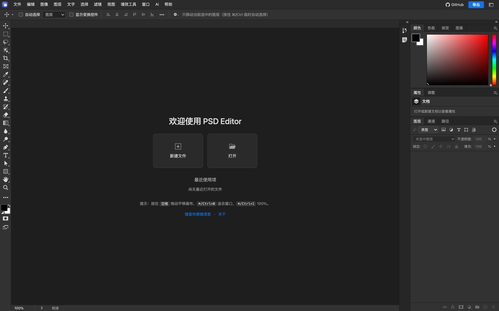

# PSD Editor

[中文文档](#中文文档) | [English](#english)




PSD Editor 是一个面向 PSD / PSB 文件的浏览器编辑器，同时提供 REST API、MCP 服务和本地 CLI。项目采用前后端同构的 PSD 内核：浏览器负责可视化编辑，Node 服务端负责文件处理、渲染、自动化接口与 AI 能力。

> 在线体验：<https://fullpsd.zaopod.com>  
> GitHub 仓库：<https://github.com/hmwl/psdeditor>

> 本项目仅供学习、研究与技术参考。请遵守当地法律法规、Adobe 软件许可协议及知识产权规定；严禁用于任何非法用途。详见文末免责声明。

---

## 中文文档

### 项目简介

PSD Editor 可以在浏览器中打开、编辑并导出 PSD / PSB 文档，也可以作为无头服务被脚本、自动化平台或 AI Agent 调用。

- **编辑器**：图层、组、蒙版、混合模式、图层样式、文字、矢量路径、调整图层、滤镜、智能对象、画板、色彩管理、选区、画笔、修饰、液化、消失点等。
- **素材替换**：替换智能对象源图，按覆盖模式渲染回智能对象；支持常规放置网格与画布变换。
- **导出**：PSD / PSB、PNG、JPEG、WebP、TIFF，以及 PDF、GIF、BMP、TGA、HDR、EXR 等格式。
- **API**：基于 Express 的 REST 接口，覆盖解析、编辑、渲染、导出、字体、档位与权限。
- **MCP**：标准 Model Context Protocol Streamable HTTP 端点，方便 Claude、Cursor、VS Code 等客户端接入。
- **CLI**：不启动浏览器即可执行 inspect、render、batch、convert 等操作，也可作为 stdio MCP 使用。
- **本地 AI**：可选的“重新打光”功能，模型在浏览器本地推理，不上传图片。

本项目只保留 **编辑器、MCP 服务、API 服务** 三项核心能力，不包含官网、文档站、在线调试台或示例 PSD 下载入口。

### 技术栈

- **运行时**：Node.js 20.11+
- **服务端**：Express 5、Sharp、Multer
- **PSD 内核**：纯 JavaScript，浏览器与 Node 共用
- **前端**：原生 ES Modules、Canvas、WebGL / WebGPU、Web Worker
- **接口**：REST、OpenAPI 3.1、MCP Streamable HTTP
- **测试**：Node 内置测试脚本、Playwright（可选浏览器测试）
- **本地 AI**：ONNX Runtime Web、MediaPipe Tasks Vision

### 目录结构

```text
.
├── bin/                 CLI 与 stdio MCP
├── core/                PSD 解析、编辑、合成、滤镜、文字、变形、格式编解码
├── server/              REST API、MCP、鉴权、档位、渲染服务
│   ├── private/         仅服务端使用的 PSD 私有算法
│   └── profiles/        ICC 色彩配置
├── web/
│   ├── editor/          浏览器编辑器
│   ├── assets/          图标、画笔/样式/图案等预设
│   └── vendor/          第三方解码库与本地 AI 模型
├── tools/               构建辅助、测试、图标与资源生成
├── deploy/              systemd 部署示例
├── .env.example         环境变量模板
└── package.json
```

### 环境要求

- Node.js **>= 20.11.0**
- npm
- 可选：Playwright + Chromium（运行浏览器测试）
- 可选：ImageMagick、Python 3 等（部分测试会使用）

### 安装

```bash
cd "PSD Editor"
npm install
npm --prefix server install
```

### 启动

```bash
npm start
```

默认地址：

```text
http://localhost:8787/
```

编辑器入口为 `/` 或 `/editor`。

开发模式（监听源码改动）：

```bash
npm run dev
```

本地调试时可以关闭 API 鉴权：

```bash
PSD_EDITOR_AUTH=off npm start
```

> `PSD_EDITOR_AUTH=off` 只允许在本机或可信内网使用。部署到公网前必须配置 API Key、HTTPS 与反向代理。

### 配置

环境变量通过 shell、systemd、Docker 或进程管理器注入，`.env.example` 是完整变量清单模板。常用变量：

| 变量 | 说明 | 默认 |
| --- | --- | --- |
| `PORT` | 服务端口 | `8787` |
| `MAX_UPLOAD_MB` | 单文件上传上限（MB） | `200` |
| `PSD_EDITOR_AUTH` | `off` 关闭鉴权，仅限本机调试 | 空 |
| `PSD_EDITOR_API_KEYS_FILE` | API Key 配置文件 | `server/api-keys.json` |
| `PSD_EDITOR_PLANS_FILE` | 档位/权限配置文件 | `server/plans.json` |
| `PSD_EDITOR_STATE_DIR` | 运行状态落盘目录 | `server/data/state` |
| `PSD_EDITOR_PUBLIC_URL` | 对外访问地址，用于生成 MCP 下载链接 | 空 |
| `PSD_EDITOR_CORS_ORIGINS` | 允许跨域的来源，逗号分隔 | 同源 |
| `PSD_EDITOR_MAX_CONCURRENT` | 重接口并发上限 | `2` |

创建 API Key：

```bash
cp server/api-keys.example.json server/api-keys.json
# 编辑 server/api-keys.json，填入随机 key
npm start
```

创建档位配置：

```bash
cp server/plans.example.json server/plans.json
```

请求时通过请求头传入 Key：

```text
X-Api-Key: your-key
```

或：

```text
Authorization: Bearer your-key
```

### REST API

常用端点：

| 方法 | 路径 | 说明 |
| --- | --- | --- |
| `GET` | `/health` | 健康检查与服务能力 |
| `GET` | `/api/catalog` | 能力目录、op 参数、滤镜、调整、预设 |
| `GET` | `/openapi.json` | OpenAPI 3.1 描述 |
| `POST` | `/api/doc/inspect` | 上传 PSD，返回图层树与文档摘要 |
| `POST` | `/api/doc/edit` | 统一编辑：属性、文字、像素、滤镜、画布、智能对象等 |
| `POST` | `/api/doc/edit/plan` | 编辑 dry-run，不产出文件 |
| `POST` | `/api/doc/render` | 按图层重新合成位图 |
| `POST` | `/api/doc/export-artboards` | 导出全部画板为 zip |
| `POST` | `/api/render` | 上传 PSD + 替换图，渲染结果 |
| `POST` | `/mcp` | MCP Streamable HTTP 端点 |

示例：

```bash
curl http://localhost:8787/health

curl -X POST http://localhost:8787/api/doc/inspect \
  -H "X-Api-Key: your-key" \
  -F "psd=@example.psd"

curl -X POST http://localhost:8787/api/doc/edit \
  -H "X-Api-Key: your-key" \
  -F "psd=@example.psd" \
  -F 'ops=[{"op":"setLayerProps","index":1,"name":"新名称"}]'
```

完整参数请读取 `/api/catalog` 或 `/openapi.json`。

### MCP

MCP 端点为：

```text
POST /mcp
```

客户端配置示例：

```json
{
  "mcpServers": {
    "psd-editor": {
      "type": "http",
      "url": "http://localhost:8787/mcp",
      "headers": {
        "X-Api-Key": "your-key"
      }
    }
  }
}
```

本地 stdio MCP：

```bash
node bin/psd_editor.js mcp
```

### CLI

```bash
node bin/psd_editor.js capabilities
node bin/psd_editor.js describe setLayerProps
node bin/psd_editor.js inspect example.psd
node bin/psd_editor.js render example.psd --out preview.png
node bin/psd_editor.js batch example.psd --input ops.json --out edited.psd
node bin/psd_editor.js convert example.psd example.png
```

### 本地 AI 模型

“重新打光”等功能使用本地 ONNX / MediaPipe 模型。仓库默认不提交大体积 `.onnx` 模型；如缺失可执行：

```bash
npm run vendor
```

该命令会下载并校验固定版本资源。所有推理均在本地完成，不上传图片。

### 测试

```bash
npm test
```

浏览器测试（需要 Playwright 与 Chromium）：

```bash
npm run test:browser
```

### 许可证

本项目自有代码采用 **MIT License**，详见 [LICENSE](LICENSE)。

以下内容 **不属于** MIT 授权范围，分别遵循其上游许可证：

- `web/vendor/` 下的第三方库、模型与运行库，详见 `web/vendor/LICENSES.txt`
- `web/assets/ps-presets/` 中的 Photoshop 预设资源，权利归各自所有者
- 其他文件中明确标注的第三方组件

使用、分发或商用前请自行核对所有第三方许可证。

### 免责声明

本项目仅供学习、研究和技术参考，不隶属于 Adobe，也不代表 Adobe 官方。Photoshop、PSD 及相关名称、商标、文件格式归 Adobe 或其各自权利人所有。

使用者必须遵守所在国家或地区的法律法规、Adobe 软件许可协议以及知识产权规定。**严禁**将本项目用于任何非法用途，包括但不限于侵犯知识产权、破解或绕过商业授权、未经授权处理他人文件、传播恶意内容或其他违法活动。

本项目按“现状”提供，不附带任何明示或暗示担保。使用者自行承担使用本项目产生的全部风险与责任；作者不对任何直接或间接损失负责。

---

## English

### Overview

PSD Editor is a browser-based editor for PSD / PSB documents, with a REST API, an MCP server, and a local CLI. The PSD kernel is shared between the browser editor and the Node.js server.

> Live demo: <https://fullpsd.zaopod.com>  
> GitHub repository: <https://github.com/hmwl/psdeditor>

> This project is provided for learning, research, and technical reference only. You must comply with applicable laws, Adobe's license terms, and intellectual-property rules. Any illegal use is strictly prohibited. See the disclaimer below.

### Features

- Open, edit, and export PSD / PSB documents.
- Layers, groups, masks, blend modes, layer styles, text, vector paths, adjustment layers, filters, smart objects, artboards, selections, brushes, retouching, liquify, and vanishing point.
- Smart-object source replacement and regular placement editing.
- Export to PSD / PSB, PNG, JPEG, WebP, TIFF, PDF, GIF, BMP, TGA, HDR, EXR, and more.
- ICC color management and CMYK workflows.
- REST API for parsing, editing, rendering, export, fonts, plans, and permissions.
- MCP Streamable HTTP endpoint for Claude, Cursor, VS Code, and other clients.
- CLI for inspect, render, batch, convert, and stdio MCP.
- Optional local AI relighting. Inference runs locally; images are not uploaded.

The project ships only the **editor**, **MCP service**, and **API service**. It does not include the former marketing site, documentation site, online API console, or sample-PSD download endpoint.


### Tech Stack

- Node.js 20.11+
- Express 5, Sharp, Multer
- Pure JavaScript PSD kernel shared by browser and server
- Native ES Modules, Canvas, WebGL / WebGPU, Web Workers
- REST, OpenAPI 3.1, MCP Streamable HTTP
- Playwright for optional browser tests
- ONNX Runtime Web and MediaPipe Tasks Vision for local AI

### Requirements

- Node.js **>= 20.11.0**
- npm
- Optional: Playwright + Chromium for browser tests
- Optional: ImageMagick, Python 3, and other tools used by some tests

### Install

```bash
cd "PSD Editor"
npm install
npm --prefix server install
```

### Run

```bash
npm start
```

Open:

```text
http://localhost:8787/
```

Development mode:

```bash
npm run dev
```

For local testing without API authentication:

```bash
PSD_EDITOR_AUTH=off npm start
```

> Never expose `PSD_EDITOR_AUTH=off` to the public internet. Use API keys, HTTPS, and a reverse proxy in production.

### Configuration

Environment variables are injected by your shell, systemd, Docker, or process manager. `.env.example` lists the available variables.

| Variable | Description | Default |
| --- | --- | --- |
| `PORT` | HTTP port | `8787` |
| `MAX_UPLOAD_MB` | Upload limit per file (MB) | `200` |
| `PSD_EDITOR_AUTH` | `off` disables authentication; local use only | empty |
| `PSD_EDITOR_API_KEYS_FILE` | API-key file | `server/api-keys.json` |
| `PSD_EDITOR_PLANS_FILE` | Plan/permission file | `server/plans.json` |
| `PSD_EDITOR_STATE_DIR` | Runtime state directory | `server/data/state` |
| `PSD_EDITOR_PUBLIC_URL` | Public base URL used for MCP links | empty |
| `PSD_EDITOR_CORS_ORIGINS` | Comma-separated allowed origins | same origin |
| `PSD_EDITOR_MAX_CONCURRENT` | Concurrency limit for heavy endpoints | `2` |

Create an API key file:

```bash
cp server/api-keys.example.json server/api-keys.json
```

Create a plan file:

```bash
cp server/plans.example.json server/plans.json
```

Send the key with either header:

```text
X-Api-Key: your-key
```

```text
Authorization: Bearer your-key
```

### REST API

| Method | Path | Description |
| --- | --- | --- |
| `GET` | `/health` | Health and capabilities |
| `GET` | `/api/catalog` | Capability catalog, op schemas, filters, adjustments |
| `GET` | `/openapi.json` | OpenAPI 3.1 document |
| `POST` | `/api/doc/inspect` | Upload a PSD and inspect its layer tree |
| `POST` | `/api/doc/edit` | Unified edit endpoint |
| `POST` | `/api/doc/edit/plan` | Dry-run edit planning |
| `POST` | `/api/doc/render` | Recomposite layers to a bitmap |
| `POST` | `/api/doc/export-artboards` | Export all artboards as a zip |
| `POST` | `/api/render` | Render replacements into a PSD |
| `POST` | `/mcp` | MCP Streamable HTTP endpoint |

Examples:

```bash
curl http://localhost:8787/health

curl -X POST http://localhost:8787/api/doc/inspect \
  -H "X-Api-Key: your-key" \
  -F "psd=@example.psd"
```

Read `/api/catalog` or `/openapi.json` for the full schemas.

### MCP

```text
POST /mcp
```

Client configuration:

```json
{
  "mcpServers": {
    "psd-editor": {
      "type": "http",
      "url": "http://localhost:8787/mcp",
      "headers": {
        "X-Api-Key": "your-key"
      }
    }
  }
}
```

Local stdio MCP:

```bash
node bin/psd_editor.js mcp
```

### CLI

```bash
node bin/psd_editor.js capabilities
node bin/psd_editor.js describe setLayerProps
node bin/psd_editor.js inspect example.psd
node bin/psd_editor.js render example.psd --out preview.png
node bin/psd_editor.js batch example.psd --input ops.json --out edited.psd
node bin/psd_editor.js convert example.psd example.png
```

### Local AI Models

Optional AI features use local ONNX / MediaPipe models. Large `.onnx` files are not committed by default. Download and verify them with:

```bash
npm run vendor
```

All inference runs locally. Images are not uploaded.

### Tests

```bash
npm test
```

Browser tests (requires Playwright and Chromium):

```bash
npm run test:browser
```

### License

The project's own source code is released under the **MIT License**. See [LICENSE](LICENSE).

The MIT license does **not** cover:

- Third-party libraries and models under `web/vendor/`; see `web/vendor/LICENSES.txt`
- Photoshop preset assets under `web/assets/ps-presets/`, which belong to their respective owners
- Other third-party components explicitly marked in their files

Check all upstream licenses before redistribution or commercial use.

### Disclaimer

This project is for learning, research, and technical reference only. It is not affiliated with Adobe and does not represent Adobe. Photoshop, PSD, and related names, trademarks, and file formats belong to Adobe or their respective owners.

You must comply with all applicable laws and regulations, Adobe's software license terms, and intellectual-property rules. **Any illegal use is strictly prohibited**, including but not limited to intellectual-property infringement, cracking or bypassing commercial licenses, unauthorized processing of other people's files, distributing malicious content, or any other unlawful activity.

The software is provided "as is", without warranty of any kind, express or implied. You use it entirely at your own risk. The authors are not liable for any direct or indirect damages.
